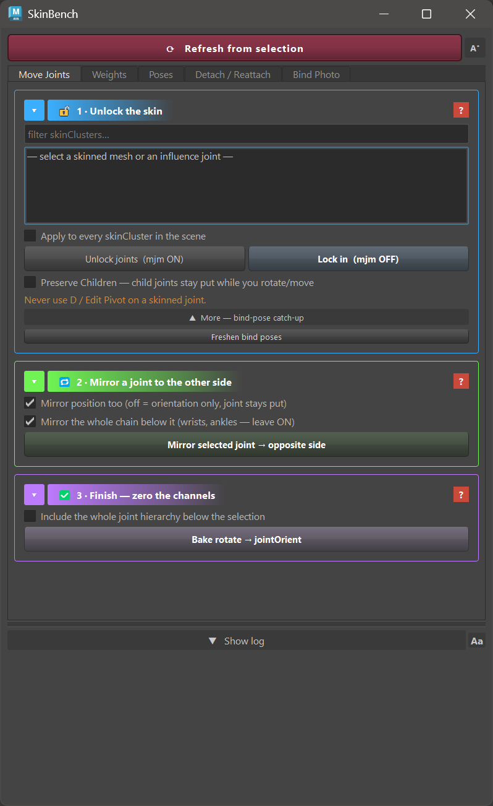

# SkinBench

Source-only skinning repair tools for Autodesk Maya.

[Releases](https://github.com/capitine/skinbench/releases) ·
[Safety](docs/safety.md) ·
[User Guide](docs/user-guide.md) ·
[Compatibility](docs/compatibility.md) ·
[Issues](https://github.com/capitine/skinbench/issues)

## What it does

SkinBench is a dockable five-tab Maya panel for repairing joint placement,
skin weights, bind data, and reusable poses. It can:

- move skinned joints while holding the mesh still;
- mirror joints and painted weights;
- save, apply, and clear poses;
- snapshot, detach, and reattach skinning;
- sync a new influence's bind photo;
- isolate driven regions, heal vertices, solve weights from a drag, and find
  bleeding weights;
- run ROM sweeps and curl chains from Maya commands.

See the [User Guide](docs/user-guide.md) for the complete workflows.

## Install

1. Download a release and extract it to a permanent folder.
2. Drag `install.py` from that folder into a Maya viewport.
3. Click the new SkinBench shelf button.

The installer writes `Documents/maya/modules/skinbench.mod`. It points Maya at
the extracted folder rather than copying the runtime. It loads the plugin,
enables Maya auto-load, and adds one shelf button. If the extracted folder is
moved, run `install.py` again from its new location. If SkinBench is already
loaded from another folder or version, the installer updates that pointer but
does not replace code inside Maya; restart Maya before using the upgrade.

Uninstall means removing the module file, shelf button, and extracted folder
after Maya is closed.

## Safety at a glance

SkinBench has no telemetry, network client, account, background service,
remote download, admin request, or registry write. JSON snapshots, daily text
logs, and UI preferences in `settings.ini` are local file writes. `Open pose
folder` and `Open log folder` invoke only a fixed operating-system folder
opener.

Explicit controls can change joint state, bind data, and skin weights in the
open scene. API weight writes are not restored by Maya Ctrl+Z; guarded writes
create a snapshot first, and artists still test on a disposable copy.

Read the full [Safety Guide](docs/safety.md) before using write controls.

## Compatibility

Live verification covers Windows 11 with Maya 2025.3.1, Python 3.11, and
PySide6. Maya 2022-2024 with Python 3 and PySide2 is syntax checked; community
testing is requested. Maya 2026 or newer, Linux, and macOS are not yet verified.
See the evidence-only [Compatibility table](docs/compatibility.md).

## Recovery

Skin-weight recovery uses JSON snapshots, not Ctrl+Z. Guarded weight-write
flows create a snapshot before they write. Snapshots are kept beside the saved
scene, or under Maya's per-user application folder for an unsaved scene.

Use the **Detach / Reattach** tab to apply a selected snapshot. Keep the oldest
snapshot from before a repair until the scene has been saved, reopened, and
checked.

## Known limits

- Polygon meshes only. NURBS and subdivision surfaces are not handled.
- Snapshot restore requires the same vertex count.
- API weight writes are not restored by Ctrl+Z.
- ROM moves one joint at a time and still needs an artist to judge the result.
- Anti-bleed uses straight-line distance plus a connected-patch check. Preview
  remains a human review gate.
- Drag solve handles selected vertices in one pose. It does not smooth the
  result into neighbouring vertices.
- The public compatibility claims are intentionally limited to recorded
  evidence.

More detail is in [Known limits](docs/user-guide.md#known-limits).

## Development provenance

Designed, directed, and live-tested by Joel Trancoso. Development was AI-assisted; releases are source-visible, independently reviewed, and tested in Maya.

The release process keeps compatibility claims tied to evidence and requires
automated policy, syntax, security, and Maya smoke checks. See
[Development](docs/development.md).

## Contributing

Bug reports, compatibility results, and focused pull requests are welcome.
Never attach a proprietary scene or skin-weight snapshot. Read
[CONTRIBUTING.md](CONTRIBUTING.md), [SUPPORT.md](SUPPORT.md), and
[SECURITY.md](SECURITY.md) before reporting or changing the project.
